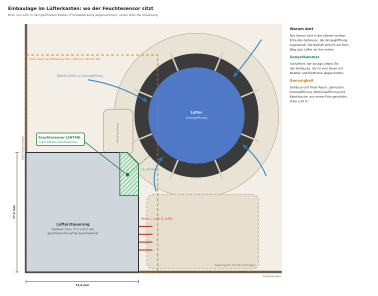

# BathFanControl

Feuchteabhängige Steuerung für einen Badlüfter (KN2 UP, ca. 50 W) an 230 V mit ESP32-C3, SHT40 und WLAN.
Platine 68 x 72,5 mm in einer Form für den Einbau im Lüfterkasten, 2 Lagen, nur von oben bestückt: SMD-Bauteile, dazu bedrahtet das Netzteil und die Netzklemme. Entworfen mit KiCad 10; alle Bauteile sind bei JLCPCB gelistet und waren am 24.11.2026 dort am Lager.

Der Lageplan zeigt, welches Bauteil wo sitzt und wozu es dient (auch als `doku/lageplan.svg`). Die Unterseite trägt keine Bauteile, dort stehen nur die Lötstifte von Netzteil und Klemme über. Sicherung, Varistor, X2-Kondensator, Triac, LED, USB-Buchse und Sensor sind in den Bildern vereinfachte Quader, weil es für sie kein fertiges 3D-Modell gibt. `doku/platine_3d.glb` lässt sich in jedem glTF-Betrachter drehen.

## Funktion

- 230 V Versorgung, zweiter 230-V-Eingang vom Lichtschalter als Aktivitätssignal
- Luftfeuchte messen (SHT40 mit Membran, nahe am Lüfter-Einlass) und den Lüfter danach schalten, mit Fortschrittskontrolle und Pausen
- Lüfter über Optotriac (Lite-On MOC3052S) und Triac (ST ACST410-8B), Lichteingang über AC-Optokoppler (LTV-814S)
- RGB-LED als Anzeige (drei GPIOs, im Gehäusedeckel ein Lichtschacht)
- Programmieren über eine stehende USB-C-Buchse (nur bei abgenommenem Deckel und ohne Netzspannung), danach Updates über WLAN
- Netzteil Hi-Link HLK-PM03 (3,3 V, 1 A), Anschluss über eine 4-polige Schraubklemme Phoenix MKDS 1,5/4-5,08

## Inhalt

| Ordner | Inhalt |
|---|---|
| [`UEBERGABE.md`](UEBERGABE.md) | Stand des Projekts, Datenblattprüfung, offene Punkte |
| [`kicad/`](kicad) | KiCad-10-Projekt: Schaltplan, Platine, Regeln, Projektbibliotheken |
| [`bestellpaket/`](bestellpaket) | Gerber, Bohrdaten, Stückliste und Bestückungsdatei (JLCPCB-Format) |
| [`doku/`](doku) | Lageplan, Einbaulage, Schaltplan als PDF, Bilder, DRC-Bericht |
| [`gehaeuse/`](gehaeuse) | Gehäuse für den 3D-Druck (OpenSCAD, STL), Entwurf für den Einbau im Lüfterkasten |
| [`skripte/`](skripte) | Skripte, die Platine und Bestellpaket neu erzeugen |

## Stand

Schaltplan- und Regelprüfung in KiCad ohne Befund. Die Platine ist noch nicht gebaut oder getestet, die Firmware fehlt.
Vor einer Bestellung die Punkte in [`UEBERGABE.md`](UEBERGABE.md), Abschnitt 6, abarbeiten.

## Sicherheit

Die Schaltung führt Netzspannung. Aufbau nur in einem geschlossenen Gehäuse, Anschluss durch eine Elektrofachkraft.
