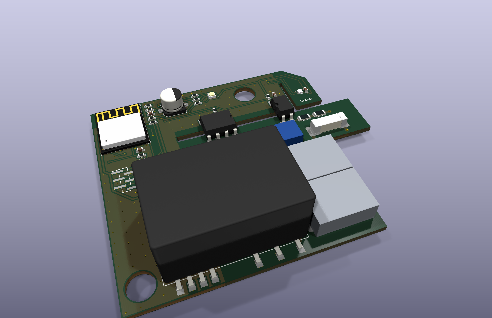

# BathFanControl

Feuchteabhängige Steuerung für einen Badlüfter (KN2 UP, ca. 50 W) an 230 V mit ESP32-C3, SHT40 und WLAN.
Platine 76 x 63 mm in einer Form für den Einbau im Lüfterkasten, 2 Lagen, ausschließlich SMD-Bauteile, nur auf der Oberseite bestückt, entworfen mit KiCad 10.

Die Unterseite trägt keine Bauteile. Klemme, Sicherung, Varistor, X2-Kondensator, LED und Sensor sind in den Bildern vereinfachte Quader, weil es für sie kein fertiges 3D-Modell gibt. `doku/platine_3d.glb` lässt sich in jedem glTF-Betrachter drehen.

## Funktion

- 230 V Versorgung, zweiter 230-V-Eingang vom Lichtschalter als Aktivitätssignal
- Luftfeuchte messen (SHT40 mit Membran, nahe am Lüfter-Einlass) und den Lüfter danach schalten, mit Fortschrittskontrolle und Pausen
- Lüfter über Photo-Triac (AQH3223A), Lichteingang über AC-Optokoppler (LTV-814S)
- RGB-LED als Anzeige (drei GPIOs, im Gehäusedeckel ein Lichtschacht)
- Netzteil Mean Well IRM-02-3.3S, Eigenverbrauch erwartet 0,2 bis 0,3 W

## Inhalt

| Ordner | Inhalt |
|---|---|
| [`UEBERGABE.md`](UEBERGABE.md) | Stand des Projekts, Datenblattprüfung, offene Punkte |
| [`kicad/`](kicad) | KiCad-10-Projekt: Schaltplan, Platine, Regeln, Projektbibliotheken |
| [`bestellpaket/`](bestellpaket) | Gerber, Bohrdaten, Stückliste und Bestückungsdatei (JLCPCB-Format) |
| [`doku/`](doku) | Schaltplan als PDF, Bilder, DRC-Bericht |
| [`gehaeuse/`](gehaeuse) | Gehäuse für den 3D-Druck (OpenSCAD, STL), Entwurf für den Einbau im Lüfterkasten |
| [`skripte/`](skripte) | Skripte, die Platine und Bestellpaket neu erzeugen |
| [`eingang/`](eingang) | ursprünglich übergebene Dateien (bedrahtete Fassung) |

## Stand

Schaltplan- und Regelprüfung in KiCad ohne Befund. Die Platine ist noch nicht gebaut oder getestet, die Firmware fehlt.
Vor einer Bestellung die Punkte in [`UEBERGABE.md`](UEBERGABE.md), Abschnitt 6, abarbeiten.

## Sicherheit

Die Schaltung führt Netzspannung. Aufbau nur in einem geschlossenen Gehäuse, Anschluss durch eine Elektrofachkraft.
