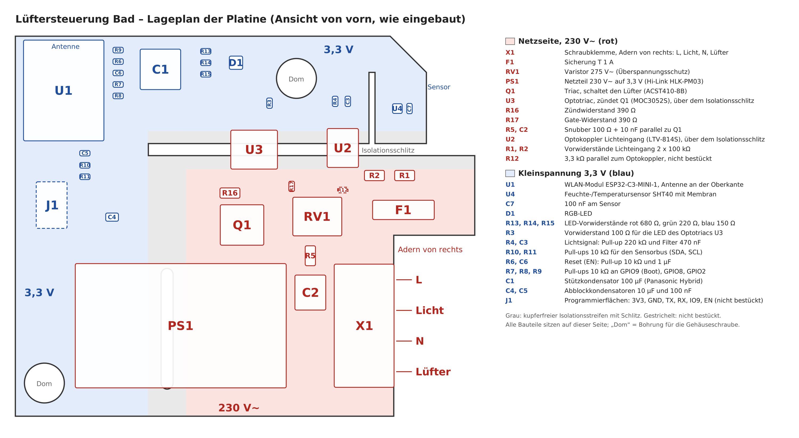
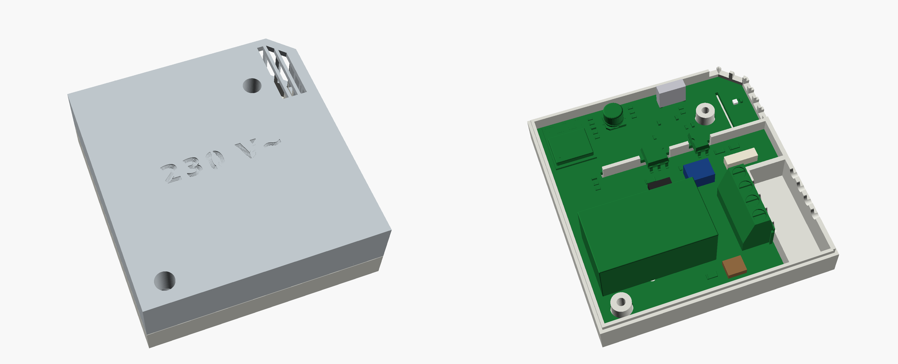

# BathFanControl

**Feuchteabhängige Steuerung für einen Badlüfter.** Die Platine sitzt direkt im Lüfterkasten, misst die Luftfeuchte und schaltet den Lüfter nur so lange, wie das Lüften tatsächlich etwas bringt. Über WLAN lässt sie sich einstellen und aktualisieren.

> [!WARNING]
> **Entwurfsstand – nicht gebaut, nicht getestet.** Schaltplan und Platine sind in KiCad ohne Befund geprüft, es gibt aber noch kein gefertigtes Muster und noch keine Firmware. Siehe [Projektstand](doku/stand.md).

> [!CAUTION]
> **Netzspannung 230 V.** Die Schaltung führt Netzspannung und wird in einem Feuchtraum eingebaut. Betrieb nur im geschlossenen Gehäuse, Anschluss durch eine Elektrofachkraft. Mehr unter [Sicherheit](#sicherheit).

## Worum geht es?

Die alte Steuerung des Badlüfters lief teilweise acht Stunden am Stück, ohne dass die Feuchte sank. BathFanControl macht es besser:

- **Misst die Luftfeuchte** mit einem Sensirion SHT40 (mit Schutzmembran) direkt am Lüfter-Einlass.
- **Prüft den Fortschritt:** Sinkt die Feuchte beim Lüften nicht (z. B. weil die Außenluft selbst feucht ist), legt die Steuerung eine Pause ein, statt weiterzulaufen.
- **Erkennt Aktivität im Bad** über einen zweiten 230-V-Eingang vom Lichtschalter.
- **Ist über WLAN erreichbar** (ESP32-C3), z. B. für Home Assistant, Einstellungen und Updates.
- **Zeigt den Zustand** über eine RGB-LED im Gehäusedeckel.

Entwickelt für einen **KN2-UP-Unterputzlüfter** (Einrohr-Lüftungssystem, ca. 50 W). Andere Lüfter mit einem Schaltkanal bis zu dieser Leistung sollten ebenfalls passen, das ist aber nicht geprüft.

## Eckdaten

| | |
|---|---|
| Versorgung | 230 V AC, Netzteil Hi-Link HLK-PM03 (3,3 V, 1 A) |
| Eingänge | Lichtschalter (230 V, galvanisch getrennt über Optokoppler) |
| Ausgang | Lüfter, geschaltet über Optotriac und Triac (Phase) |
| Sensor | Sensirion SHT40-AD1F-R2, Temperatur und relative Feuchte |
| Controller | Espressif ESP32-C3-MINI-1 (WLAN, USB eingebaut) |
| Anschluss | 4-polige Schraubklemme: L, Licht, N, Lüfter |
| Programmieren | USB-C auf der Platine (nur ohne Netzspannung), danach per WLAN |
| Platine | 68 x 72,5 mm, 2 Lagen, nur von oben bestückt, alle Teile bei JLCPCB lieferbar |
| Gehäuse | 72,6 x 77,1 x 25,7 mm, 3D-Druck |
| Entwurfswerkzeuge | KiCad 10, OpenSCAD |

## Bilder

| Lageplan der Bauteile | Gehäuse geschlossen und offen |
|---|---|
|  |  |

Weitere Ansichten: [Platine von allen Seiten](doku/platine_3d_ansichten.png), [Einbaulage im Lüfterkasten](doku/einbaulage.svg), [3D-Modell zum Drehen](doku/platine_3d.glb) (glTF), [Schaltplan als PDF](doku/schaltplan.pdf).

## Nachbauen in fünf Schritten

1. **Verstehen:** [Funktion und Regellogik](doku/funktion.md) und [Schaltung](doku/schaltung.md) lesen.
2. **Prüfen:** die [Checkliste vor der Bestellung](doku/bestellen.md) abarbeiten.
3. **Bestellen:** Platine samt Bestückung mit dem [Bestellpaket](bestellpaket/LIESMICH.md) bei JLCPCB bestellen.
4. **Gehäuse drucken:** [Gehäuse](gehaeuse/README.md) aus flammhemmendem Material drucken.
5. **Aufbauen:** Firmware aufspielen, Platine lackieren, einbauen und anschließen lassen: [Aufbau und Einbau](doku/aufbau.md).

## Dokumentation

| Seite | Inhalt |
|---|---|
| [Funktion](doku/funktion.md) | Aufgabe, Lüfter, Regellogik der Firmware, WLAN |
| [Schaltung](doku/schaltung.md) | Funktionsblöcke, GPIO-Belegung, Bauteilauswahl, Datenblattprüfung |
| [Platine](doku/platine.md) | Eckdaten, Anordnung der Bauteile, Isolation, Leiterbahnen |
| [Bestellen](doku/bestellen.md) | Checkliste vor der Bestellung, Lagerbestand, Ausweichtypen |
| [Aufbau und Einbau](doku/aufbau.md) | Programmieren, Schutzlack, Anschluss, Montage |
| [Projektstand](doku/stand.md) | Was geprüft ist, was offen ist |
| [Gehäuse](gehaeuse/README.md) | 3D-Druck-Gehäuse: Aufbau, Dateien, offene Punkte |
| [Bestellpaket](bestellpaket/LIESMICH.md) | Fertigungsdaten für JLCPCB |
| [Skripte](skripte/README.md) | Platine und Bestellpaket neu erzeugen |

## Ordner

| Ordner | Inhalt |
|---|---|
| [`kicad/`](kicad) | KiCad-10-Projekt: Schaltplan, Platine, Designregeln, Projektbibliotheken |
| [`bestellpaket/`](bestellpaket) | Gerber, Bohrdaten, Stückliste und Bestückungsdatei im JLCPCB-Format |
| [`gehaeuse/`](gehaeuse) | Gehäuse: OpenSCAD-Modell, STL-Dateien, Bilder |
| [`doku/`](doku) | Dokumentation, Lageplan, Einbaulage, Schaltplan-PDF, Bilder, DRC-Bericht |
| [`skripte/`](skripte) | Skripte, die Platine und Bestellpaket neu erzeugen |

## Sicherheit

- Die Schaltung führt **Netzspannung**. Arbeiten nur im spannungsfreien Zustand.
- Betrieb nur im **geschlossenen Gehäuse**, außerhalb des Spritzbereichs.
- **Anschluss durch eine Elektrofachkraft** vornehmen bzw. abnehmen lassen.
- **USB nur anstecken, wenn die Platine vom Netz getrennt ist.**
- Bei Einrohrsystemen am gemeinsamen Schacht: **Brandschutzklappe nicht verändern.**
- Das Gehäuse ist ein Entwurf ohne Schutzart und ohne Normprüfung.

Nachbau und Betrieb auf eigene Verantwortung.

## Lizenz

© 2026 [nager-code](https://github.com/nager-code)

[CC BY-SA 4.0](LICENSE) – Weitergabe und Bearbeitung erlaubt, mit Namensnennung und unter gleichen Bedingungen.
