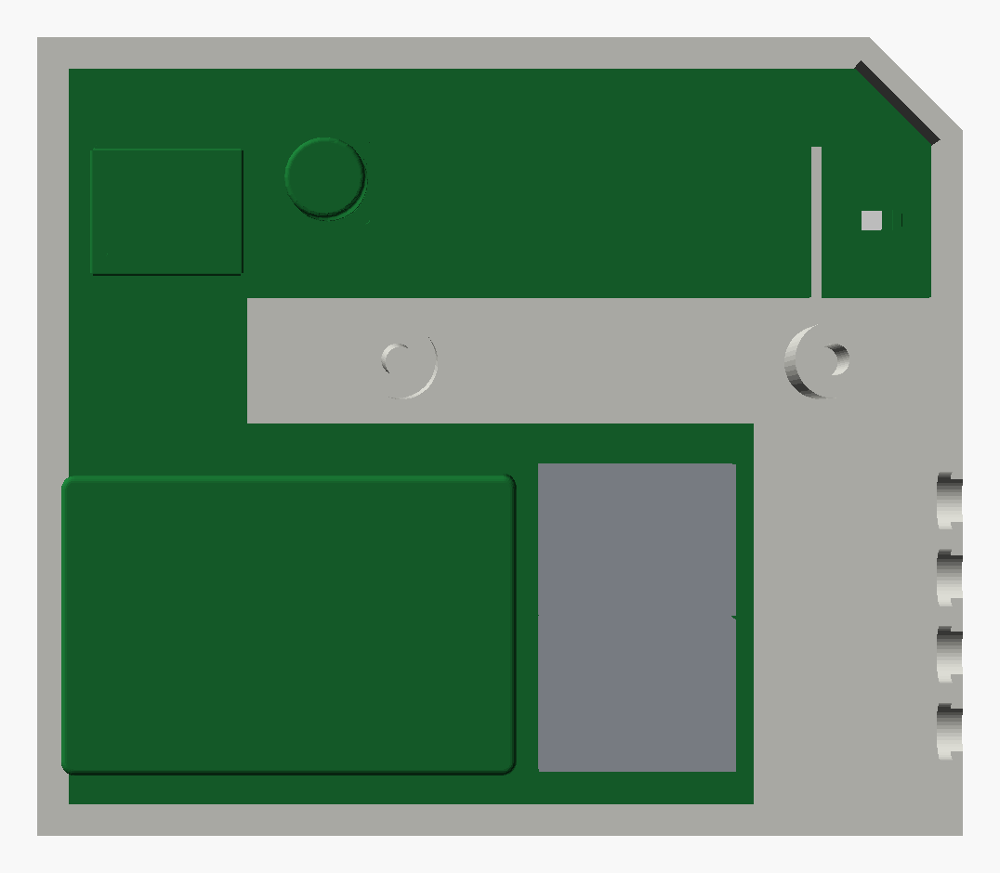
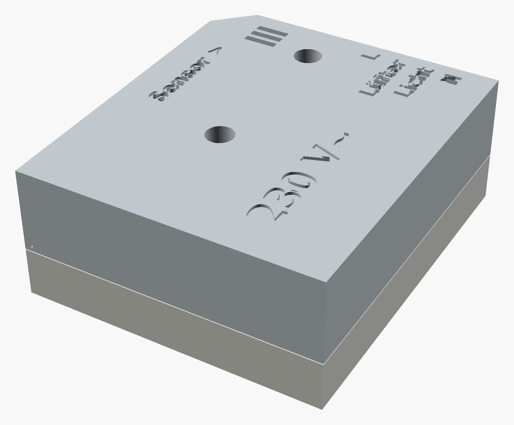

# Gehäuse (Entwurf v3 für Platine v1.2, noch nicht gedruckt)

Zweiteiliges Gehäuse aus Wanne und Deckel für den Einbau unten links im Lüfterkasten, vor dem Lüftergehäuse. Netzteil und Klemmen liegen unten, die Leitungen kommen von rechts, der Feuchtesensor sitzt oben rechts hinter der abgeschrägten Ecke zum Lüfter-Einlass. Parametrisches OpenSCAD-Modell, druckbar ohne Stützmaterial.





## Maße

| | |
|---|---|
| Außen | 72,6 breit x 62,6 hoch x 28,0 mm tief |
| Wandstärke | 2 mm |
| Druckvolumen | Wanne 17,8 cm³, Deckel 19,8 cm³ |

## Aufbau

- **Einbaulage** wie in den Bildern von vorn gesehen: linke Seite an der Kastenwand, Unterseite auf dem Kastenboden, Rückseite vor dem Lüftergehäuse. Rückseite, linke Seite und Unterseite sind glatt; in den Lüfterkasten wird nicht gebohrt.
- **Platine** liegt mit ihren Kanten auf 1,2 mm breiten Leisten der Wanne (sie hat keine Bohrungen). Rippen im Deckel drücken sie an elf Stellen auf die Leisten.
- **Anschlussraum unten rechts**, 14 mm tief. Die vier Adern kommen gerade von rechts durch je eine Öffnung (4,5 mm) in der Trennfuge und werden beim Schließen umfasst. Klemmenbelegung im Deckel eingeprägt, von oben nach unten: L, Lüfter, Licht, N.
- **Doppelte Zwischenwand** im Spalt zwischen Riegel und Arm: Netzteil und Anschlussraum sind vom Sensorarm getrennt. Im Kanal dazwischen sitzen die beiden Schraubdome.
- **Sensorkammer oben rechts:** eine weitere Trennwand schottet die Sensorinsel ab. Lüftungsschlitze nur dort – in der abgeschrägten Ecke zum Einlass, in der rechten Wand, oben und vorn –, also ausschließlich auf der 3,3-V-Seite.
- **Verschluss:** zwei Kunststoffschrauben 3 x 12 mm von vorn (Kernloch 2,5 mm), dazu rundum ein Falz mit 1,5 mm Überlappung. Öffnen nur mit Werkzeug.

## Dateien

| Datei | Inhalt |
|---|---|
| `gehaeuse.scad` | Modell mit allen Maßen als Parameter |
| `wanne.stl`, `deckel.stl` | Druckdateien; der Deckel liegt schon mit der Deckelfläche nach unten |
| `platine_bestueckt.stl` | 3D-Modell der bestückten Platine aus KiCad (nur zur Kontrolle und für die Bilder) |
| `pruefe_kollision.py` | prüft Wanne und Deckel gegen die Platine und gegeneinander |

Neu erzeugen:

```bash
openscad -D 'teil="wanne"' -o wanne.stl gehaeuse.scad
```

```bash
openscad -D 'teil="deckel"' -o deckel.stl gehaeuse.scad
```

## Geprüft

Rechnerische Kontrolle gegen das 3D-Modell der Platine: keine Durchdringung, Wanne und Deckel überschneiden sich nicht. Der kleinste Abstand zu einem Bauteil beträgt 0,65 mm in der Wanne (Auflageleiste zur Sicherung) und 0,55 mm im Deckel (Niederhalter zum Netzteil). Klemme, Sicherung, Varistor, X2-Kondensator und Sensor gingen als Quader in den Datenblattmaßen in die Prüfung ein.

## Offen und vor dem Druck zu klären

1. **Lage im Kasten.** Bis zur Frontabdeckung sind laut Messung etwa 50 mm Tiefe frei, das Gehäuse braucht 28 mm. Die Lage von Kabeltasche, Wartungsklappe und Einlass ist dagegen nur aus Fotos geschätzt (±10 %): danach bleiben rechts etwa 5 mm bis zur Kabeltasche, oben etwa 10 mm bis zur Wartungsklappe, und die abgeschrägte Ecke liegt rund 15 mm vor dem Rand der Ansaugöffnung. Vor der Bestellung der Platine mit einer Pappschablone 73 x 63 mm im Kasten prüfen; ob Rippen oder der Filter der Frontabdeckung in den Raum ragen, ist nicht geprüft.
2. **Höhe der Aderöffnungen.** Sie sitzen 2,7 mm über der Platine auf Höhe der angenommenen Leitereinführung der WAGO 2061; das Maß ist nicht aus dem Datenblatt belegt (`z_teil`).
3. **Leitungsaustritt.** Die Adern verlassen das Gehäuse waagrecht nach rechts und müssen kurz danach vor der Kabeltasche nach unten abbiegen. Mit den flexiblen Litzen im Kasten geht das, mit starren Adern wäre es eng.
4. **Verschraubung.** Zwei Schrauben auf der Mittellinie; ob der Deckel an den Ecken sauber anliegt, zeigt erst ein Probedruck.
5. **Werkstoff.** Flammhemmendes Material nehmen (UL 94 V-0), z. B. entsprechend ausgewiesenes PETG, ABS oder PC. Normales PLA ist ungeeignet, auch wegen der feuchtwarmen Luft im Lüfterkasten.
6. **Befestigung.** Vorgesehen ist doppelseitiges Klebeband auf der linken Seite (zur Kastenwand) oder auf der Rückseite; Flächen vorher entstauben und entfetten.
7. **Feuchte.** Durch den Kasten strömt die Badluft. Die Platine sollte einen Schutzlack bekommen; Sensor (Membran), Klemmen und Programmierpads aussparen.
8. Kein Schutzgrad und keine Normprüfung: das ist ein Entwurf, kein geprüftes Installationsgehäuse.
