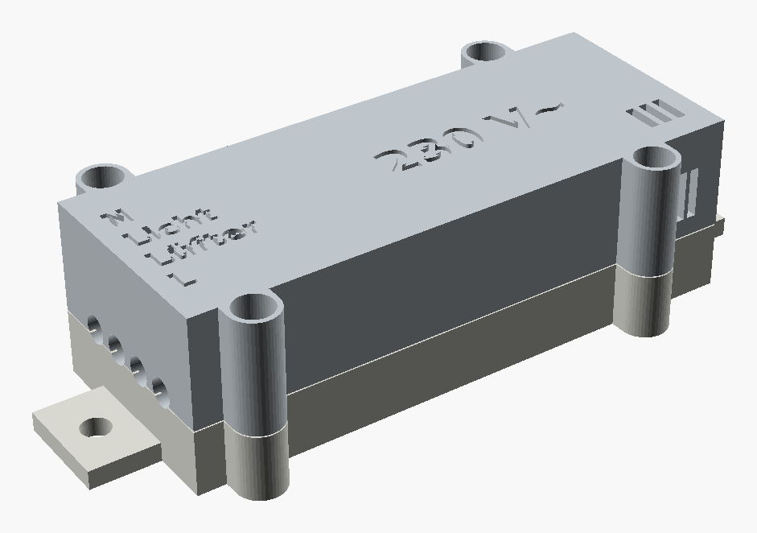
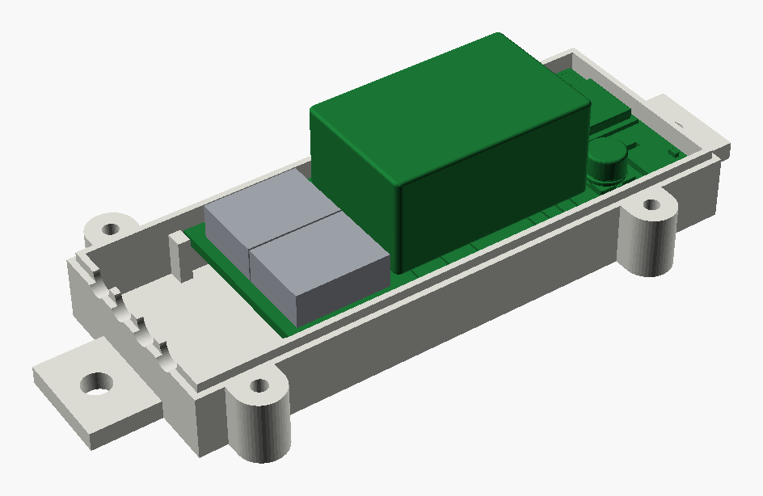
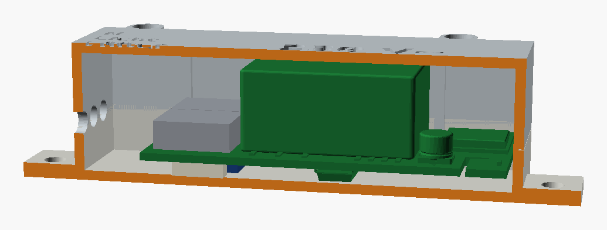
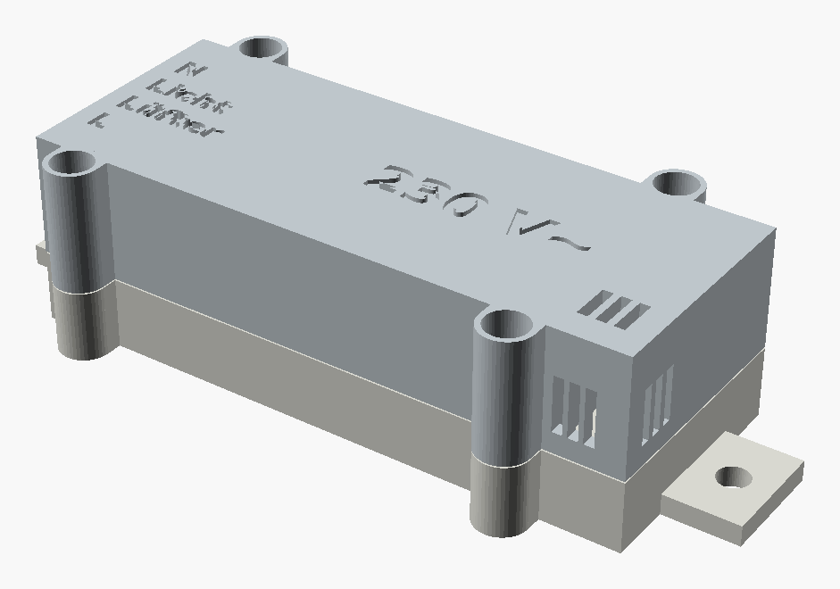

# Gehäuse (Entwurf v1, noch nicht gedruckt)

Zweiteiliges Gehäuse für die Platine v1.1: Wanne und Deckel, verschraubt mit vier Schrauben. Parametrisches OpenSCAD-Modell, druckbar ohne Stützmaterial.






## Maße

| | |
|---|---|
| Außen ohne Laschen | 89,6 x 34,6 x 28,0 mm |
| Breite über die Schraubdome | 47,0 mm |
| Länge mit Befestigungslaschen | 111,6 mm |
| Wandstärke | 2 mm |
| Druckvolumen | Wanne 14,0 cm³, Deckel 14,7 cm³ |

## Aufbau

- **Platine** liegt mit den Längskanten auf zwei 1,2 mm breiten Leisten der Wanne (die Platine hat keine Bohrungen). Zwei Anschläge links und die Stirnwand rechts halten sie in Längsrichtung, Rippen im Deckel drücken sie an sechs Stellen auf die Leisten.
- **Anschlussraum** 15 mm vor den Klemmen. Die vier Adern liegen in halbrunden Öffnungen (4,5 mm) in der Trennfuge und werden beim Schließen des Deckels umfasst. Reihenfolge wie an der Klemme: N, Licht, Lüfter, L – im Deckel eingeprägt.
- **Sensorkammer:** zwei Trennwände im Deckel schotten die Ecke mit dem SHT40 vom Netzteil ab. Nur dort gibt es Lüftungsschlitze (je drei in Längswand, Stirnwand und Decke, 1,5 mm breit), also ausschließlich auf der 3,3-V-Seite.
- **Verschraubung:** vier Dome außen an den Längsseiten, Kunststoffschrauben 3 x 12 mm von oben, Kernloch 2,5 mm. Öffnen nur mit Werkzeug.
- **Falz** zwischen Wanne und Deckel (1,5 mm Überlappung).
- **Befestigung:** zwei Laschen mit 4,5-mm-Loch an den Stirnseiten, abschaltbar mit `laschen = false`.

## Dateien

| Datei | Inhalt |
|---|---|
| `gehaeuse.scad` | Modell mit allen Maßen als Parameter |
| `wanne.stl`, `deckel.stl` | Druckdateien; der Deckel liegt schon mit der Decke nach unten |
| `platine_bestueckt.stl` | 3D-Modell der bestückten Platine aus KiCad (nur zur Kontrolle und für die Bilder) |
| `pruefe_kollision.py` | prüft Wanne und Deckel gegen die Platine |

Neu erzeugen:

```bash
openscad -D 'teil="wanne"' -o wanne.stl gehaeuse.scad
```

```bash
openscad -D 'teil="deckel"' -o deckel.stl gehaeuse.scad
```

## Geprüft

Rechnerische Kontrolle gegen das 3D-Modell der Platine: keine Durchdringung. Der kleinste Abstand zu einem Bauteil beträgt 0,65 mm in der Wanne (Auflageleiste zur Sicherung) und 0,5 mm im Deckel (Trennwand zum Elko). Klemme, Sicherung, Varistor und X2-Kondensator gingen als Quader in den Datenblattmaßen in die Prüfung ein.

## Offen und vor dem Druck zu klären

1. **Höhe der Leitereinführung.** Die Aderöffnungen sitzen 2,7 mm über der Platine. Das Maß ist für die WAGO 2061 angenommen, nicht aus dem Datenblatt belegt (`z_teil` im Modell).
2. **Werkstoff.** Für ein Netzspannungsgehäuse flammhemmendes Material nehmen (UL 94 V-0), z. B. entsprechend ausgewiesenes PETG, ABS oder PC. Normales PLA ist ungeeignet.
3. **Passung.** `spiel` (0,3 mm rundum) und `fuge` (0,2 mm) an den eigenen Drucker anpassen; ein Probedruck der Wanne zeigt, ob die Platine sauber einliegt.
4. **Zugentlastung** gibt es keine. Für fest verlegte Einzeladern aus der Wand reicht das meist; bei einer flexiblen Leitung fehlt sie.
5. **Einbauort.** Das Gehäuse ist nicht spritzwassergeschützt (Lüftungsschlitze, offene Fuge). Es gehört außerhalb des Spritzbereichs montiert.
6. Kein Schutzgrad und keine Normprüfung: das ist ein Entwurf, kein geprüftes Installationsgehäuse.
