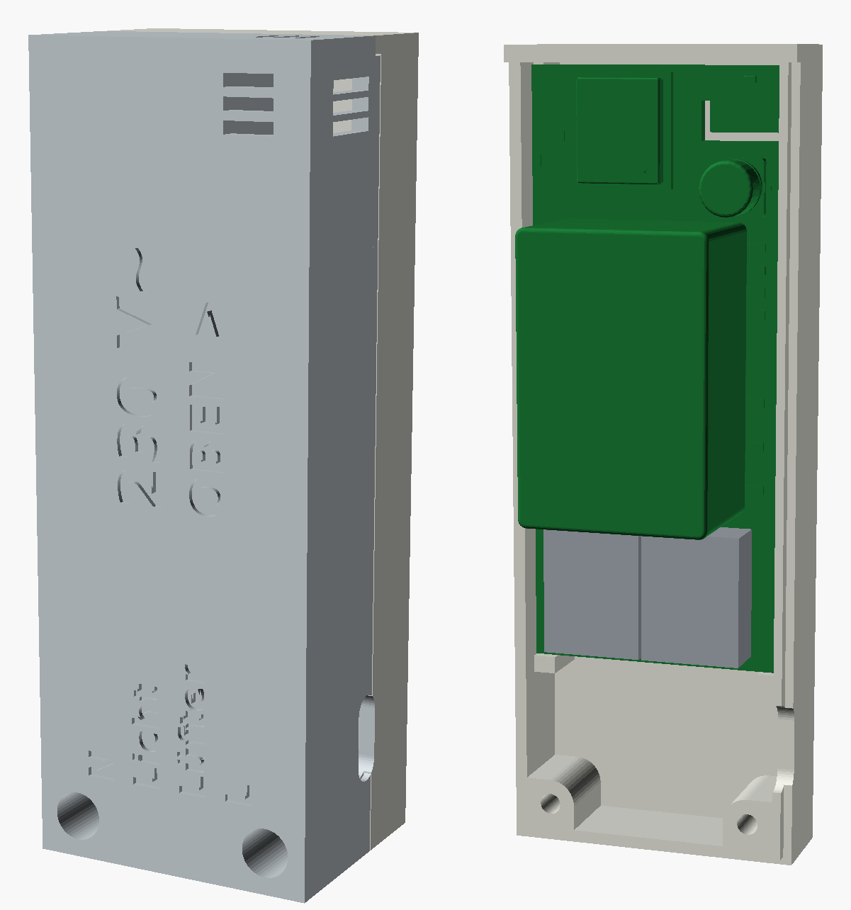

# Gehäuse (Entwurf v2 für den Einbau im Lüfterkasten, noch nicht gedruckt)

Zweiteiliges Gehäuse für die Platine v1.1. Es steht hochkant in der linken unteren Ecke des Unterputzkastens, im Raum vor dem Lüftergehäuse: Klemmen unten, Feuchtesensor oben rechts und damit am Luftstrom zum Lüfter. Parametrisches OpenSCAD-Modell, druckbar ohne Stützmaterial.




## Maße

| | |
|---|---|
| Außen | 95,1 hoch x 34,6 breit x 28,0 mm tief |
| Wandstärke | 2 mm |
| Druckvolumen | Wanne 12,7 cm³, Deckel 14,5 cm³ |

Die Platine selbst bleibt unverändert: hochkant gedreht liegt ihr Sensor bereits oben rechts.

## Aufbau

- **Platine** liegt mit den Längskanten auf zwei 1,2 mm breiten Leisten der Wanne (sie hat keine Bohrungen). Zwei Anschläge und die obere Stirnwand halten sie in Längsrichtung, Rippen im Deckel drücken sie an sechs Stellen auf die Leisten.
- **Glatte Rückseite und glatte linke Seite**, damit das Gehäuse in der Ecke an Rückwand und Seitenwand anliegt. Keine Laschen, keine außenliegenden Schraubdome; in den Lüfterkasten wird nicht gebohrt.
- **Anschlussraum unten**, 20 mm hoch. Die vier Adern kommen gemeinsam durch eine Öffnung (10,5 x 4,5 mm) in der rechten Seitenwand, also von dort, wo die Leitungen am Kastenboden liegen. Die Öffnung liegt in der Trennfuge und wird beim Schließen umfasst. Klemmenbelegung im Deckel eingeprägt: N, Licht, Lüfter, L.
- **Sensorkammer oben rechts:** zwei Trennwände im Deckel schotten die Ecke mit dem SHT40 vom Netzteil ab. Lüftungsschlitze nur dort – nach rechts zum Lüfter, nach oben und nach vorn –, also ausschließlich auf der 3,3-V-Seite.
- **Verschluss:** oben hängt der Deckel mit einer Nase in der Wanne ein, unten halten ihn zwei Kunststoffschrauben 3 x 12 mm (Kernloch 2,5 mm). Öffnen nur mit Werkzeug.
- **Falz** zwischen Wanne und Deckel an drei Seiten (1,5 mm Überlappung).
- „OBEN >“ und „230 V~“ sind im Deckel eingeprägt.

## Dateien

| Datei | Inhalt |
|---|---|
| `gehaeuse.scad` | Modell mit allen Maßen als Parameter |
| `wanne.stl`, `deckel.stl` | Druckdateien; der Deckel liegt schon mit der Decke nach unten |
| `platine_bestueckt.stl` | 3D-Modell der bestückten Platine aus KiCad (nur zur Kontrolle und für die Bilder) |
| `pruefe_kollision.py` | prüft Wanne und Deckel gegen die Platine und gegeneinander |

Neu erzeugen:

```bash
openscad -D 'teil="wanne"' -o wanne.stl gehaeuse.scad
```

```bash
openscad -D 'teil="deckel"' -o deckel.stl gehaeuse.scad
```

## Geprüft

Rechnerische Kontrolle gegen das 3D-Modell der Platine: keine Durchdringung, Wanne und Deckel überschneiden sich nicht. Der kleinste Abstand zu einem Bauteil beträgt 0,65 mm in der Wanne (Auflageleiste zur Sicherung) und 0,4 mm im Deckel (Steg der Einhängenase zum Kondensator C7). Klemme, Sicherung, Varistor und X2-Kondensator gingen als Quader in den Datenblattmaßen in die Prüfung ein.

## Offen und vor dem Druck zu klären

1. **Einbauort: vor dem Lüftergehäuse, nicht daneben.** Neben dem Lüftergehäuse ist die Ecke zu schmal (geschätzt nur etwa 75 mm Breite in 15 mm Höhe, 50 mm in 30 mm, 35 mm in 45 mm, 26 mm in 60 mm, 21 mm in 75 mm Höhe). Zwischen der Vorderseite des Lüftergehäuses und der Frontabdeckung sind aber laut Messung etwa 50 mm Tiefe frei; das Gehäuse braucht 28 mm, es bleiben rund 22 mm Luft bis zur Abdeckung. Es steht also hochkant unten links auf dem Kastenboden, links an der Kastenwand, oben mit dem Rücken vor dem Lüftergehäuse. Die Wartungsöffnung der Rückstauklappe und die Ansaugöffnung müssen frei bleiben; ob Rippen oder der Filter der Frontabdeckung in diesen Raum ragen, ist nicht geprüft.
2. **Einhängenase.** Ob sich der Deckel sauber einschwenken lässt, zeigt erst ein Probedruck (Spiel 0,2 mm, Eingriff 0,8 mm).
3. **Höhe der Leitungsöffnung.** Sie sitzt 2,7 mm über der Platine auf Höhe der angenommenen Leitereinführung der WAGO 2061; das Maß ist nicht aus dem Datenblatt belegt (`z_teil`).
4. **Enge im Anschlussraum.** Die Adern müssen auf rund 14 mm Länge um 90° zu den Klemmen gebogen werden. Für flexible Litzen ist das machbar, für starre 1,5-mm²-Adern knapp; `kammer` vergrößern, wenn die Höhe es erlaubt.
5. **Werkstoff.** Flammhemmendes Material nehmen (UL 94 V-0), z. B. entsprechend ausgewiesenes PETG, ABS oder PC. Normales PLA ist ungeeignet, auch wegen der feuchtwarmen Luft im Lüfterkasten.
6. **Befestigung.** Vorgesehen ist doppelseitiges Klebeband auf der linken Seite (zur Kastenwand); die Rückseite liegt nur oben am Lüftergehäuse an. Flächen vorher entstauben und entfetten.
7. **Feuchte.** Durch den Kasten strömt die Badluft. Die Platine sollte einen Schutzlack bekommen (Sensor, Klemmen und Programmierpads aussparen).
8. Kein Schutzgrad und keine Normprüfung: das ist ein Entwurf, kein geprüftes Installationsgehäuse.
