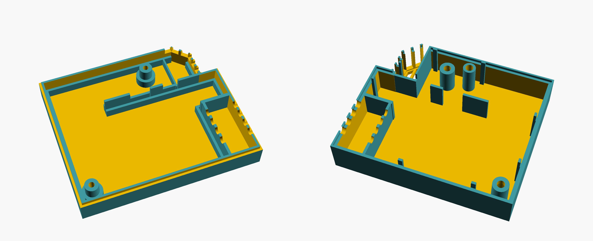

# Gehäuse (Entwurf v7 für Platine v1.7, noch nicht gedruckt)

Zweiteiliges Gehäuse aus Wanne und Deckel für den Einbau unten links im Lüfterkasten, vor dem Lüftergehäuse. Netzteil und Klemmen liegen unten, die Leitungen kommen von rechts, der Feuchtesensor sitzt oben rechts hinter der abgeschrägten Ecke zum Lüfter-Einlass. Parametrisches OpenSCAD-Modell, druckbar ohne Stützmaterial.




## Maße

| | |
|---|---|
| Außen | 72,6 breit x 77,1 hoch x 25,7 mm tief |
| Wandstärke | 2 mm |
| Druckvolumen | Wanne 19,3 cm³, Deckel 20,1 cm³ |

## Aufbau

- **Einbaulage** wie in den Bildern von vorn gesehen: linke Seite an der Kastenwand, Unterseite auf dem Kastenboden, Rückseite vor dem Lüftergehäuse. Rückseite, linke Seite und Unterseite sind glatt; in den Lüfterkasten wird nicht gebohrt.
- **Platine** ist nur von oben bestückt und liegt 4 mm über dem Boden auf Leisten der Wanne; darunter ist Platz für die Lötstifte von Netzteil (bis 3,4 mm) und Klemme. Zwei Dome der Wanne gehen durch die Bohrungen der Platine (unten links unter dem Netzteil und oben rechts im Arm) und halten sie in Position. Rippen im Deckel drücken sie an acht Stellen auf die Leisten.
- **Grundsatz:** Luft und Feuchte sollen möglichst nur an den Sensor kommen. Öffnungen hat das Gehäuse deshalb nur an der Sensorkammer; der Raum mit Netzteil, Klemme und Elektronik ist ringsum geschlossen. Dicht im Sinn einer Schutzart ist es nicht: Trennfuge, Aderöffnungen und Schraubdome sind ohne Dichtung.
- **Sensorkammer oben rechts**, möglichst offen: zwei Fenster 3,6 mm in der abgeschrägten Ecke zum Einlass, vier Fenster 3,0 mm in der rechten Wand, eines oben, dazu drei Öffnungen 2,2 mm in der Deckelfläche über die ganze Kammer. In der Kammer liegt nur die Sensorinsel der Platine (3,3 V).
- **Abschottung der Kammer:** links vom Thermoschlitz reicht eine Wand des Deckels bis 0,1 mm an die Platine, darunter steht eine Wand der Wanne bis an die Platinenunterseite; nach unten schließt der Steg im Isolationsschlitz ab. Über den schmalen Platinensteg oben laufen die vier Leiterbahnen zum Sensor unter der Wand hindurch. Wer den Restspalt schließen will, legt dort beim Zusammenbau eine dünne Raupe neutral vernetzendes Silikon auf die Platine.
- **Anschlussraum unten rechts**, 11,9 mm tief, im Ausschnitt der Platine vor der Schraubklemme. Die vier Adern kommen gerade von rechts durch je eine Öffnung (3,4 mm, Raster 5,08 mm) in der Außenwand und durch eine zweite in der Innenwand direkt vor der Klemme; beide liegen in der Trennfuge und umfassen die Adern beim Schließen. Der Anschlussraum ist damit eine eigene Kammer vor dem Geräteraum. Die Schrauben der Klemme sind nur bei abgenommenem Deckel erreichbar. Klemmenbelegung im Deckel eingeprägt, von oben nach unten: L, Licht, N, Lüfter.
- **Trennung Netz / 3,3 V:** im 2 mm breiten Isolationsschlitz der Platine steht ein Steg der Wanne, den eine Rippe des Deckels bis zur Decke fortsetzt – überall außer unter den beiden Optokopplern.
- **USB-C-Buchse:** sie steht 7,5 mm hoch auf der Platine und liegt unter dem geschlossenen Deckel. Zum Programmieren den Deckel abnehmen (Netzspannung vorher abschalten); eine Öffnung im Gehäuse gibt es dafür nicht.
- **Lichtschacht der RGB-LED:** ein Rohr im Deckel (innen 3,6 mm) reicht bis 2 mm über die LED. In der Deckelfläche bleibt ein 0,6 mm dünnes Fenster stehen; das Licht ist nur mit hellem oder transparentem Filament zu sehen. Mit `led_fenster = 0` wird daraus ein offenes Loch.
- **Verschluss:** zwei Kunststoffschrauben 3 x 10 mm von vorn in die Dome (Kernloch 2,5 mm, 10 mm tief), dazu rundum ein Falz mit 1,5 mm Überlappung. Öffnen nur mit Werkzeug. Beide Schrauben sitzen im 3,3-V-Bereich, mehr als 10 mm vom Netzkupfer entfernt.

## Dateien

| Datei | Inhalt |
|---|---|
| `gehaeuse.scad` | Modell mit allen Maßen als Parameter |
| `wanne.stl`, `deckel.stl` | Druckdateien; der Deckel liegt schon mit der Deckelfläche nach unten |
| `platine_bestueckt.stl` | 3D-Modell der bestückten Platine aus KiCad (nur zur Kontrolle und für die Bilder) |
| `pruefe_kollision.py` | prüft Wanne und Deckel gegen die Platine und gegeneinander |

Neu erzeugen:

```bash
openscad -D 'teil="wanne"' -o wanne.stl gehaeuse.scad
```

```bash
openscad -D 'teil="deckel"' -o deckel.stl gehaeuse.scad
```

## Geprüft

Rechnerische Kontrolle gegen das 3D-Modell der Platine: keine Durchdringung, Wanne und Deckel überschneiden sich nicht. Der kleinste Abstand beträgt 0,6 mm in der Wanne (Boden zu den ungekürzten Stiften des Netzteils) und 0,6 mm im Deckel (Innenwand zur Vorderseite der Klemme). Netzteil und Klemme gingen mit ihren KiCad-3D-Modellen in die Prüfung ein, Sicherung, Varistor, X2-Kondensator, Triac, LED, USB-Buchse und Sensor als Quader in den Datenblattmaßen.

## Offen und vor dem Druck zu klären

1. **Lage im Kasten.** Nachgemessen stehen am Einbauort höchstens 85 mm Breite, 40 mm Tiefe und 140 mm Höhe zur Verfügung (Messung vom 24.11.2026). Das Gehäuse braucht 72,6 x 25,7 x 77,1 mm: in der Breite bleiben 12,4 mm für die rechts austretenden Adern, in der Tiefe 14,3 mm, in der Höhe 62,9 mm. Die Lage von Ansaugöffnung, Wartungsöffnung und Kabeltasche ist nur aus einem Foto geschätzt (±10 %), siehe `../doku/einbaulage.svg`: danach reicht die Oberkante des Gehäuses bis an die Unterkante der Wartungsöffnung der Rückstauklappe (etwa 76 mm über dem Kastenboden), und die abgeschrägte Ecke liegt rund 19 mm vor dem Rand der Ansaugöffnung. Vor dem Druck mit einer Pappschablone 73 x 77 mm prüfen, ob die Wartungsöffnung frei bleibt; ob Rippen oder der Filter der Frontabdeckung in den Raum ragen, ist nicht geprüft.
2. **Aderöffnungen.** Der Durchmesser 3,4 mm (`ader_d`) ist eine Annahme, die Adern im Kasten sind nicht vermessen: an den Außendurchmesser anpassen, damit möglichst wenig Luft durchkommt, und den Rest bei Bedarf mit dauerelastischer Dichtmasse schließen.
3. **Höhe der Aderöffnungen.** Sie sitzen 3,6 mm über der Platine. Das Maß ist am KiCad-3D-Modell der MKDS 1,5 gemessen (Öffnung 2,4 bis 4,9 mm über der Platine); das Datenblatt bemaßt die Höhe der Leitereinführung nicht (`z_teil`).
4. **Leitungsaustritt.** Die Adern verlassen das Gehäuse waagrecht nach rechts in Richtung Kabeltasche. Mit den flexiblen Litzen im Kasten geht das, mit starren Adern wäre es eng.
5. **Verschraubung.** Zwei Schrauben, unten links und oben rechts im Arm. Die Ecken unten rechts am Anschlussraum und oben links sind am weitesten von beiden entfernt; ob der Deckel dort sauber anliegt, zeigt erst ein Probedruck.
6. **Steg im Isolationsschlitz.** Er ist 1,2 mm stark und hat zu beiden Seiten 0,4 mm Luft zur Platine. Wenn die Platine beim Einlegen klemmt, `st0`/`st1` anpassen.
7. **Lichtschacht.** Ob die LED durch das 0,6-mm-Fenster hell genug ist, hängt vom Filament ab und ist nicht erprobt.
8. **Werkstoff.** Flammhemmendes Material nehmen (UL 94 V-0), z. B. entsprechend ausgewiesenes PETG, ABS oder PC. Normales PLA ist ungeeignet, auch wegen der feuchtwarmen Luft im Lüfterkasten.
9. **Befestigung.** Vorgesehen ist doppelseitiges Klebeband auf der linken Seite (zur Kastenwand) oder auf der Rückseite; Flächen vorher entstauben und entfetten.
10. **Feuchte.** Durch den Kasten strömt die Badluft. Die Platine sollte einen Schutzlack bekommen; Sensor (Membran), Klemmen, LED und Programmierpads aussparen.
11. Kein Schutzgrad und keine Normprüfung: das ist ein Entwurf, kein geprüftes Installationsgehäuse.
